<p align="center"></p>

# TI:IT TOP — Telegram-бот для турниров Dota 2

Асинхронный production-бот на **aiogram 3.x + SQLAlchemy 2.x (aiosqlite)**: регистрация игроков,
верификация Steam, команды, турниры, заявки, связь с организаторами и полноценная админ-панель.

## Возможности

- 🏠 Главное меню (Reply Keyboard), `/start` без дублей и без сброса регистрации.
- 👤 Профиль игрока: Steam ID64 / Account ID / ссылка профиля / vanity-ссылка.
- 🔎 Верификация: Steam → Dotabuff → STRATZ. Ошибки провайдеров (403 Cloudflare, таймауты)
  **не отклоняют** игрока: валидная личность + недоступная статистика ⇒ `PENDING` и ручная проверка.
  Dotabuff используется первым; OpenDota — только безопасный fallback при недоступности Dotabuff. Успешные проверки кэшируются (TTL = `PROFILE_CACHE_TTL`).
- 👑 Команды: создание капитаном, добавление/удаление игроков по @username или Telegram ID,
  защита от дублей и двух капитанов.
- 🏆 Турниры: список, карточка, подача заявки командой со всеми проверками (статус игроков,
  открытая регистрация, лимит команд, запрет двойных заявок).
- 📋 Заявки: статусы DRAFT/PENDING/APPROVED/REJECTED/CANCELLED, решения админа с комментарием
  и уведомлением капитана.
- 💬 Поддержка: тикеты уходят только администраторам, ответ — `/reply <номер> <текст>` или кнопкой.
- ⚙️ Админ-панель: пользователи, команды, турниры (FSM-создание), заявки, очередь верификации
  (✅/❌/🔄 recheck), поддержка, статистика. Права — строго по `ADMIN_IDS` (проверяется в каждом
  хендлере, callback не доверенный).

## Структура

```
bot.py            # точка входа: .env, БД, Bot/Dispatcher, polling, shutdown
config.py         # загрузка .env, is_admin()
database/         # engine (async), models, repositories
handlers/         # start, profile (+регистрация), team, tournaments, applications, support
handlers/admin/   # panel, users, teams, tournaments, applications, verification, support
keyboards/        # main, registration, team, tournament, application, admin
services/         # player_verification, steam/dotabuff/stratz providers, cache, teams,
                  # tournaments, applications, registration, support, sheets (optional)
utils/            # validation, formatting, logging_setup
tests/            # pytest: парсинг ID, верификация (mocks 403/timeout), команды, турниры,
                  # заявки, админ-права, поддержка, целостность БД, smoke test
```

## Установка

Требования: **Python 3.12+**.

```bash
python -m venv .venv
# Windows:
.venv\Scripts\activate
# Linux/macOS:
source .venv/bin/activate

pip install -r requirements.txt
```

Скопируйте `.env.example` в `.env` и заполните:

| Переменная | Обязательно | Описание |
|---|---|---|
| `BOT_TOKEN` | ✅ | Токен бота от @BotFather |
| `ADMIN_IDS` | ✅ | Telegram ID админов через запятую: `123456789,987654321` |
| `DATABASE_URL` | — | По умолчанию `sqlite+aiosqlite:///./tournament.db` |
| `STEAM_API_KEY` | — | Ключ Steam Web API (усиливает проверку личности) |
| `STRATZ_API_TOKEN` | — | Опционально, для STRATZ GraphQL |
| `STRATZ_API_URL` | — | По умолчанию `https://api.stratz.com/graphql` |
| `PROFILE_CACHE_TTL` | — | TTL кэша проверок, сек (по умолчанию 1800) |

Все секреты — только через окружение. Без `STEAM_API_KEY`, Dotabuff и STRATZ бот полностью
работоспособен: игроки уходят на ручную проверку (`PENDING`).

## Запуск

```bash
python bot.py
```

База создаётся автоматически (`CREATE TABLE IF NOT EXISTS`), при перезапуске данные сохраняются
(никаких DROP/удалений БД).

## Тестирование

```bash
python -m pytest        # все тесты работают на mocks, сеть не нужна
python -m compileall .
```

## Cloudflare / 403 и VPN (Dotabuff, STRATZ)

Если браузер через VPN открывает dotabuff.com и stratz.com, а бот получает 403 —
причина в том, что запросы бота идут мимо туннеля (у Python нет «системного прокси»
как у браузера) и/или по питоновскому TLS-отпечатку. Что сделано в боте:

1. **curl_cffi + impersonate** — реальный TLS/H2-отпечаток Chrome (`HTTP_IMPERSONATE`).
2. **Автопоиск локального VPN-прокси** — бот сканирует порты 7890/7891/7892/7893,
   10808/10809, 1080/1081, 8888, 8118, 3128 и др., проверяет каждый CONNECT-рукопожатием
   к dotabuff и использует первый рабочий. То есть если MantaRay слушает локальный
   HTTP-порт — бот сам пустит трафик через твой же туннель.
3. **Перебор кандидатов**: прямой выход → системный прокси → все найденные VPN-порты.
4. **Диагностика в админке** («🌐 Диагностика API») показывает: curl_cffi, используемый
   прокси, список обнаруженных VPN-портов, внешний IP бота, статус Steam/Dotabuff/STRATZ.

Что проверить, если статистика всё ещё не тянется:
* В MantaRay включи режим **System Proxy** или узнай его локальный mixed-порт
  (обычно 7890) и пропиши `HTTP_PROXY_URL=http://127.0.0.1:7890` в `.env`.
* Убедись, что в `.env` задан `STRATZ_API_TOKEN` (без токена STRATZ отвечает 401/403 всегда).
* Сравни «Внешний IP бота» из диагностики с IP из https://2ip.ru под VPN — они должны совпасть.
* Выбери в VPN ноду без блокировки стриминга/Cloudflare (Италия из твоего профиля подходит).

Ничего из этого не ломает регистрацию: при недоступности источников игрок уходит в PENDING
с ручной проверкой организаторами.


## Troubleshooting

- **Бот не отвечает** — проверьте `BOT_TOKEN`, что бот не запущен вторым экземпляром (webhook/polling).
- **Dotabuff/STRATZ 403** — ожидаемо (Cloudflare); игрок уходит в PENDING, это не ошибка.
- **Игрок «уже состоит в команде»** — штатная защита от дублей состава.
- **Логи** не содержат токенов (секреты замаскированы).
- Google Sheets интеграция опциональна и отключена без credentials — SQLite достаточно.

## Почему Dotabuff/STRATZ отдают 403 и что с этим делать

Cloudflare фильтрует запросы по двум признакам: **IP** (целые диапазоны VPS/датацентров)
и **TLS-отпечаток клиента** (у Python aiohttp он «не браузерный»). Поэтому браузер
через VPN сайт открывает, а скрипт — получает 403 (`Cf-Mitigated: challenge`).

Что сделано в боте:
1. `curl_cffi` (в requirements) эмулирует реальный TLS/H2-отпечаток Chrome
   (`HTTP_IMPERSONATE`, по умолчанию `chrome126`);
2. автоматическое определение системного прокси (Windows-реестр / env), плюс явный
   `HTTP_PROXY_URL` в `.env` (например `http://127.0.0.1:7890` для локального VPN);
3. цепочка транспортов: curl_cffi → aiohttp → urllib → curl.exe;
4. админ-панель → «🌐 Диагностика API»: показывает внешний IP бота, наличие curl_cffi,
   прокси, статус каждого источника и точную причину отказа;
5. недоступность источников НИКОГДА не отклоняет игрока — только PENDING + ручная
   проверка организатором (статус VERIFIED при этом выдаётся по официальным данным Steam/Valve).

Если диагностика показывает датацентровый IP — поможет запуск с домашнего интернета,
VPN с резидентным IP или указание `HTTP_PROXY_URL` на тот же VPN, через который
браузер открывает сайты.


### Team/registration flow
- Exact MMR is entered manually by the player and is only range-validated automatically.
- Every new Steam registration and every exact-MMR submission sends an admin notification with a direct verification button.
- Free-agent search shows only players who are free and whose exact MMR has been manually verified.
- Incoming team invitations can be opened from the team menu.
- Start banner uses `static/banner.mp4` via Telegram animation; GIF is not used.

## ВАЖНО: расположение SQLite-базы

Единственная рабочая база проекта — `tournament.db` **в той же папке, где находится `bot.py`**.

Бот автоматически преобразует относительный `DATABASE_URL=sqlite+aiosqlite:///./tournament.db` в абсолютный путь к этой папке. Поэтому запуск из VS Code, PowerShell или другого рабочего каталога больше не создаёт отдельные `tournament.db`.

Не запускайте несколько копий проекта с разными папками и не создавайте вручную дополнительные `tournament.db`.

### Mini App 3.2 additions — AI Agent + read-only DB tools
- Admin-only AI assistant now works as a **read-only agent**: the model asks the server for exactly the data it needs instead of receiving the whole database on every request.
- Available tools cover users/profiles, teams/rosters/MMR, team MMR ordering, tournaments, applications, invites, verification log, support, chat, events, notifications, administrators, plus an on-demand full operational snapshot.
- The model never receives the bot token, AI key, Telegram initData, cookies, `.env` or filesystem access. Text stored in the DB is treated as untrusted data to reduce prompt-injection risk.
- Default free provider: OpenRouter `openrouter/free`. Set only `AI_API_KEY` to start. `AI_MAX_TOOL_ROUNDS` controls the maximum number of tool rounds per question.
- Optional direct provider: Google AI Studio / Gemini. Use `AI_BASE_URL=https://generativelanguage.googleapis.com/v1beta/openai/chat/completions` and `AI_MODEL=gemini-3.8-flash`.
- AI response telemetry returns the selected model, tools used, number of tool calls and generation time; secrets are not returned.
- Frontend/API error formatting is hardened so object/array payloads do not become `[object Object]`.

### Как получить бесплатную AI для Mini App

**Вариант 1 — OpenRouter (рекомендуемый минимум настроек).**
1. Открой `https://openrouter.ai/` и создай аккаунт.
2. В dashboard создай API key. На текущей странице разработчиков OpenRouter указывает, что для старта не требуется подписка или карта.
3. В `.env` проекта укажи:
```env
AI_API_KEY=твой_ключ
AI_BASE_URL=https://openrouter.ai/api/v1/chat/completions
AI_MODEL=openrouter/free
AI_MAX_TOOL_ROUNDS=5
```
4. Перезапусти бота. В Mini App → Админка → 🤖 AI-помощник можно сразу задавать вопросы.

`openrouter/free` — это бесплатный роутер: OpenRouter выбирает доступную бесплатную модель и, по документации, фильтрует варианты под необходимые возможности, включая tool calling. Бесплатные варианты имеют нулевую цену токенов, но действуют лимиты/ограничения бесплатного доступа, поэтому это не гарантия неограниченных запросов.

**Вариант 2 — Google AI Studio / Gemini.**
Google сейчас даёт бесплатный уровень Gemini API с бесплатными input/output tokens для доступных на Free Tier моделей. Для проекта уже добавлена OpenAI-совместимая настройка:
```env
AI_API_KEY=твой_Gemini_ключ
AI_BASE_URL=https://generativelanguage.googleapis.com/v1beta/openai/chat/completions
AI_MODEL=gemini-3.8-flash
AI_MAX_TOOL_ROUNDS=5
```
Google документирует function calling через этот OpenAI-compatible API. Учти: на бесплатном уровне Google указывает, что содержимое может использоваться для улучшения продуктов; политика хранения/обучения у конкретного провайдера бесплатной модели может отличаться. Не передавай AI ничего, что не нужно для администраторской аналитики.

### Какие вопросы AI уже умеет разбирать

Например: `Сколько сейчас зарегистрировано игроков?`; `Покажи всех игроков с подтверждённым MMR`; `Какой средний подтверждённый MMR у команды X?`; `Какие заявки сейчас pending?`; `Есть ли открытые обращения поддержки по словам "рейтинг команд"?`; `Какие уведомления непрочитаны у пользователя 123?`; `Какие команды сейчас выше по среднему подтверждённому MMR?`; `Разбери последние события и чат по слову ...`.

Важное различие: **средний подтверждённый MMR — не турнирный рейтинг**. В текущей схеме проекта нет отдельной таблицы результатов матчей, поэтому AI не должен придумывать победы/поражения. Для будущего настоящего рейтинга добавьте таблицы матчей/серий и потом отдельный read-only tool для них.


### Mini App 3.3 additions — Free AI fallback

The admin AI now has an automatic free-provider chain:
- OpenRouter `openrouter/free` as the primary route;
- OpenRouter `qwen/qwen3.8-27b:free` as a same-key free fallback;
- optional Groq `openai/gpt-oss-120b` as an independent backup via `AI_BACKUP_API_KEY`.

All three use the existing `HTTP_PROXY_URL`, so AI traffic can follow the same HTTP proxy/VPN path already used by the project. The browser cannot choose arbitrary model IDs.


## Mini App 3.5
Ранги централизованы: canonical rank_tier, корректные границы MMR, обработка zero-star compatibility tiers и Immortal leaderboard rank. Actual медаль не заменяется расчётом по MMR; MMR-derived rank всегда помечается как ориентировочный.

### Расформирование команды
Капитан может расформировать собственную команду из Telegram и Mini App. Действие требует подтверждения. Команда с APPROVED-заявкой на турнир защищена от удаления; для неё нужно обратиться к организатору. При обычном удалении освобождаются все участники, удаляются незавершённые заявки и приглашения и очищается локальный аватар.
